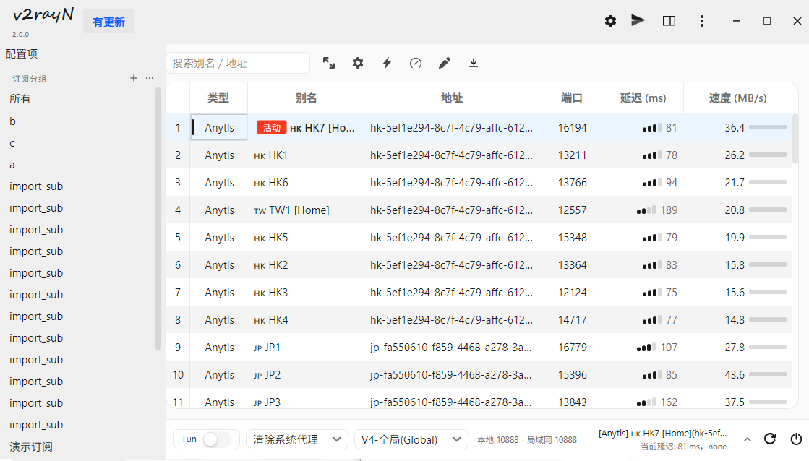
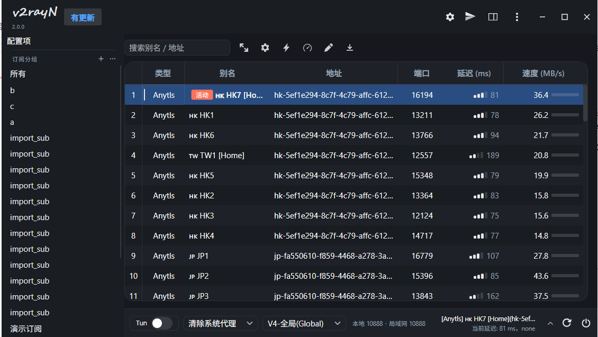

# v2rayN 2.0（界面重制分支）

基于 [v2rayN](https://github.com/2dust/v2rayN) **7.25.6** 的界面重制分支：只改界面与少量交互，**不动内核、不动协议实现**，可直接替换官方 exe 使用。

当前版本 **2.0.0** ｜ [下载](https://github.com/NZNL31/v2rayN-2.0/releases/latest) ｜ [界面示例](示例.md)

> 本仓库不包含任何节点、订阅或配置数据；截图中出现的节点仅为演示用途。





> 更多界面细节（含深色主题）见 [示例.md](示例.md)

## 安装（给使用者）

**方式一：一键脚本**

```powershell
.\install.ps1                          # 装到 %USERPROFILE%\v2rayN-2.0
.\install.ps1 -TargetDir "D:\v2rayN"   # 覆盖到已有安装目录（会先备份 exe）
.\install.ps1 -Proxy "http://127.0.0.1:10808"   # 走代理下载
```

**方式二：手动**

1. 到 [Releases](../../releases) 下载 `v2rayN-windows-64.zip`
2. 解压，把里面的文件覆盖到 v2rayN 目录（`guiConfigs` / `bin` 保留不动）

**方式三：自己编**（见下方「构建」）

## 更新机制（重点）

本分支把 **v2rayN 本体的自更新指向了本仓库的 Release**，所以：

- 程序内「检查更新」里的 **v2rayN** 一项，检查的是 **NZNL31/v2rayN-2.0** 的发布
- 更新下来的是**带界面的构建**，不会出现"更新后 UI 变回原版"
- 内核（Xray / mihomo / sing-box）与 GeoFiles 仍然各自走官方源，可以放心更新

> 首次安装后如果程序提示 v2rayN 更新失败，说明本仓库还没有发布版本；发布一次即可正常。

## 改了什么

**顶栏（自绘，无系统标题栏）**

- 左侧 `v2rayN` 手写体 logo + 版本号小字
- 右侧：齿轮（设置）/ 纸飞机（帮助）/ 侧栏开关 / ⋮ / 最小化·最大化·关闭（40×32，描边 1.55）
- 双击顶栏最大化，四边与四角为自绘缩放热区

**左栏（232px，通到底）**

- `配置项` 为纯文字一级入口，点击弹出「添加服务器」菜单
- 分隔线 + 灰色小标题 `订阅分组` + 右侧 `＋` / `⋯`
- 二级列表：无缩进、圆角胶囊、斑马纹、选中浅底、可拖拽排序

**节点表格**

- 斑马纹、表头 11.5px 居中、行高 38
- 延迟列 = 4 段信号条 + 数字；速度列 = 进度条 + 数字（未测试不显示）
- 别名 / 地址按比例伸缩（默认 2:3，拖拽后记住比例），长文本省略号
- 窄屏按 `订阅分组 → 传输协议 → TLS → IP 信息 → 今日/总上传下载 → 端口 → 速度 → 延迟` 顺序自动隐藏，宽屏自动恢复
- 无残余横向滚动条（列宽交给布局引擎按星号比例分配）
- 搜索框输入即过滤（250ms 防抖）、`✕` 清除、`Ctrl+F` 聚焦、空状态提示

**状态栏（命令栏式，46px）**

- `Tun` 描边胶囊 + 系统代理 / 路由两个描边下拉 + 单行端口信息 + 实时上下行速率
- 右侧节点两行（名称 + 延迟/地区），右端 `︿ ⟳ ⏻`

**托盘图标**

- 四种系统代理模式各自一枚 N 标：清除（银）/ 自动配置（红）/ 不改变（紫）/ PAC（金）
- 多尺寸 ICO + 单帧 PNG，边缘做过去白处理，深色任务栏无白边

**更新策略**

- 本体自更新指向本仓库 Release（见上「更新机制」），更新不会丢界面
- 内核 Xray / mihomo / sing-box 与 GeoFiles 仍走官方源


## 构建

```powershell
dotnet publish v2rayN/v2rayN.Desktop/v2rayN.Desktop.csproj `
  -c Release -r win-x64 --self-contained true -o <输出目录>
```

依赖 .NET SDK 10。产物为单文件 `v2rayN.exe`。

## 升级上游

本分支按「补丁集」维护：`custom` = 上游某个提交 + **1 个定制提交**（56 个文件）。升级时把定制提交重放到新版上游之上即可，冲突只可能出现在这些文件里。

```powershell
# 拉上游新版本 -> 重放定制提交 -> 编译 -> 备份并部署
.\update-v2rayn.ps1 -Target latest -Build -Deploy
```

有冲突时脚本会停在临时分支、列出冲突文件，且**不编译不部署**，成品 exe 不受影响。

## 许可

与上游一致，遵循 GPL-3.0（见 `LICENSE`）。本项目为个人定制分支，与 v2rayN 官方无关；界面设计参考 Docker Desktop 风格。
