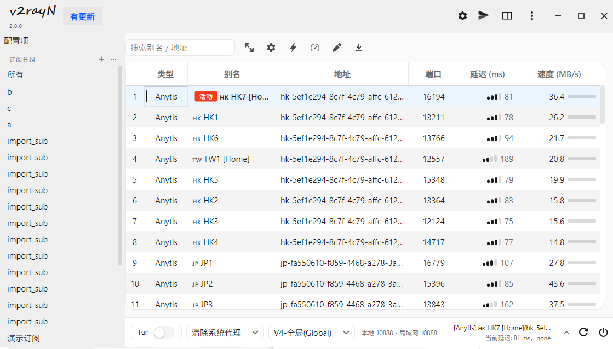
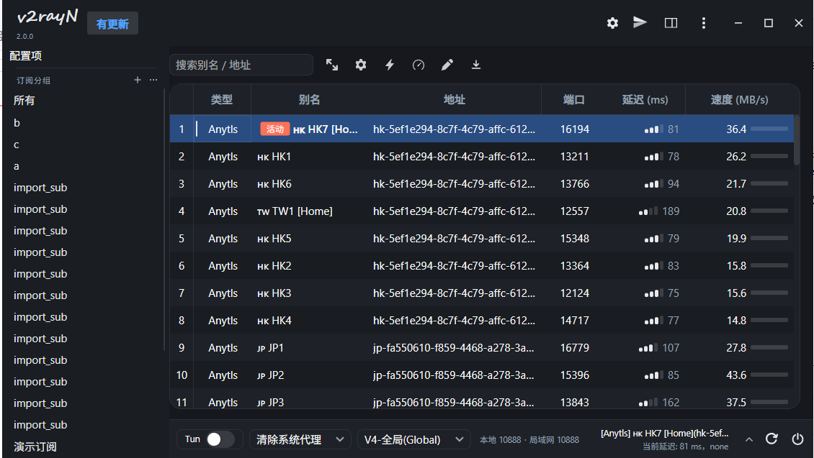

# 界面示例

浅色 / 深色两套主题下的主界面（同一份配置，切换主题后自动跟随）。

## 浅色

## 深色

## 图上都能看到什么

**顶栏**

- 左侧 `v2rayN` 手写体 logo + 版本号 `2.0.0`
- `有更新` 蓝色小标签：检测到可更新内容时出现（内核或本体）
- 右侧图标：齿轮（设置）/ 纸飞机（帮助）/ 侧栏开关 / `⋮` / 最小化·最大化·关闭
- 整条顶栏可拖动，双击最大化

**左栏（232px）**

- `配置项`：纯文字一级入口，点击弹出「添加服务器」菜单
- `订阅分组` 灰色小标题 + 右侧 `＋`（新增订阅）/ `⋯`（订阅分组菜单）
- 分组项为圆角胶囊：悬停浅底、选中加深并加粗，可拖拽排序

**工具栏**

- 搜索框（输入即过滤，`Ctrl+F` 聚焦，`✕` 清除）
- 展开列宽 / 列设置 / 一键测速 / 多线程测速 / 编辑当前订阅 / 更新当前订阅

**节点表格**

- 斑马纹隔行底色，表头 11.5px 居中，行高 38
- 类型、端口居中；别名与地址按 2:3 比例伸缩，超长省略号
- 延迟列：4 段信号条（越慢越短）+ 数字
- 速度列：单色进度条（按 100 Mbps 归一化）+ 数字
- 当前使用的节点：左侧 2px 竖条 + 别名加粗 + `活动` 红色标签
- 未测试（延迟 ≤0 / 速度 =0）不显示条和数字
- 窄屏时按 订阅分组 → 传输协议 → TLS → IP 信息 → 今日/总流量 → 端口 → 速度 → 延迟 的顺序自动隐藏，宽屏自动恢复

**状态栏（46px）**

- `Tun` 描边胶囊开关
- 系统代理下拉（清除 / 自动配置 / 不改变 / PAC）
- 路由下拉
- 端口信息：`本地 10888 · 局域网 10888`
- 实时上下行速率：`↑ 12 KB ↓ 3.4 MB`
- 右侧当前节点两行：名称 + 延迟/地区
- 右端 `︿`（折叠信息面板）/ `⟳`（重启服务）/ `⏻`（退出）
